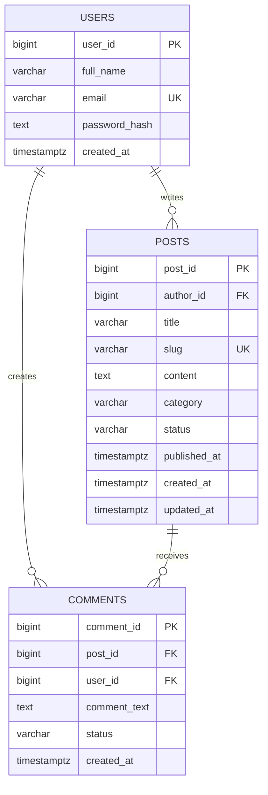

# THE EDIT
## Blog Database — Entity Relationship Diagram

This diagram represents the relationships between the three main entities in the blog database: Users, Posts and Comments.

## Relationship Explanation

| Relationship | Description |
|---|---|
| Users → Posts | One user can write many posts. |
| Users → Comments | One user can create many comments. |
| Posts → Comments | One post can receive many comments. |

## Key Constraints

- **Primary Keys (PK):** Uniquely identify each record.
- **Foreign Keys (FK):** Connect related records across tables.
- **Unique Constraints (UK):** Prevent duplicate email addresses and post slugs.
- **One-to-Many:** A single user or post can be associated with multiple records.
